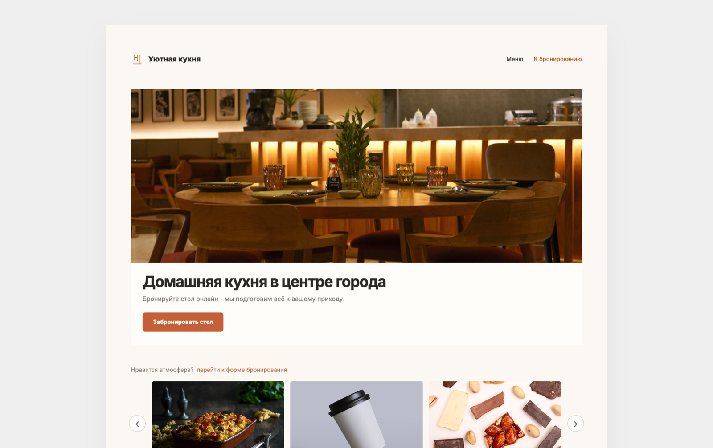

# «Уютная кухня» — лендинг кафе

Одностраничный сайт кафе домашней кухни: первый экран, галерея блюд и атмосферы, частые вопросы и форма бронирования стола.

**Демо:** https://grisha4455.github.io/Landing-Cafe/

## Что внутри

- Первый экран с фото и призывом забронировать стол
- Галерея блюд и интерьера
- Блок «Частые вопросы»
- Форма бронирования стола с подтверждением «Заявка отправлена»
- Адаптивная вёрстка под телефон и компьютер

## Стек

HTML, CSS, JavaScript — без фреймворков и сборки.

## Запуск

Откройте `index.html` в браузере.
